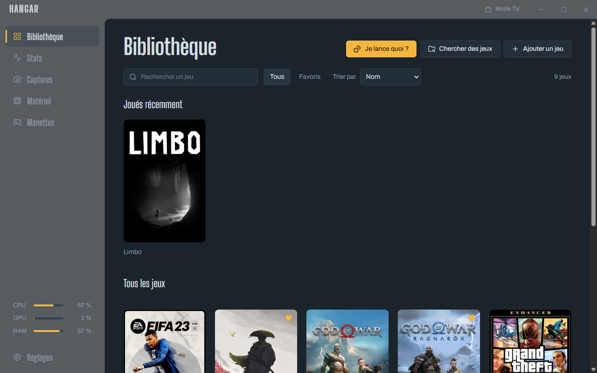
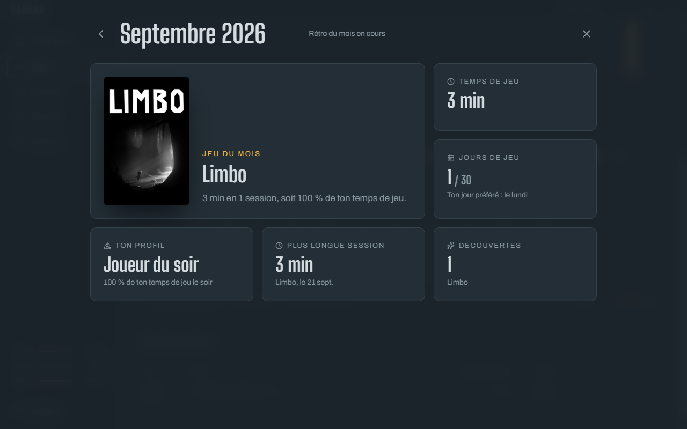
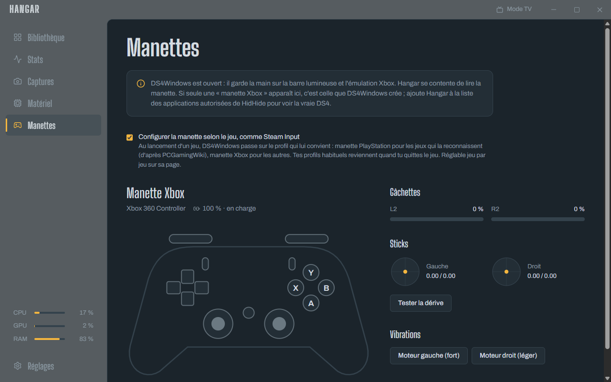

# Hangar

Un lanceur de jeux pour Windows : il retrouve tes jeux, compte le temps que tu passes dessus,
surveille ton matériel en direct, lit tes manettes et sauvegarde tes parties. Les jeux installés à
la main comptent autant que ceux de Steam ou d'Epic : mêmes jaquettes, mêmes stats, mêmes
sauvegardes.

Application portable : tout ce qu'elle écrit tient dans son propre dossier `data`, rien n'est
installé ailleurs sur la machine.



## Ce qu'il sait faire

- **Bibliothèque** — scan de Steam et d'Epic, ajout d'un jeu par glisser-déposer (un `.exe`, un
  raccourci ou un dossier), jaquettes, fonds et logos depuis SteamGridDB, collections, favoris.
- **Temps de jeu** — un suivi en arrière-plan compte chaque partie, même lancée hors de Hangar, et
  retrouve ses petits après un plantage. Résumé à la fin de chaque session, stats par jour, par mois
  et par jeu, calendrier sur un an avec la série de jours consécutifs.
- **Matériel en direct** — processeur, carte graphique, mémoire, disques, réseau, batterie, et les
  températures pendant la partie. La température du processeur passe par un petit service à part, qui
  lit les capteurs via [PawnIO](https://pawnio.eu/).
- **Manettes** — DualShock 4, DualSense, manettes Xbox : diagnostic des boutons, des sticks et des
  gâchettes, test de dérive, vibrations, batterie. Hangar cohabite avec DS4Windows plutôt que de le
  remplacer.
- **Profil de manette par jeu**, dans l'esprit de Steam Input — au lancement, DS4Windows passe sur le
  profil qui convient au jeu (manette PlayStation pour ceux qui la reconnaissent, d'après
  [PCGamingWiki](https://www.pcgamingwiki.com/), manette Xbox pour les autres), puis tes profils
  habituels reviennent.
- **Sauvegarde des parties** avec [Ludusavi](https://github.com/mtkennerly/ludusavi) — automatique à
  la fin de chaque session, plusieurs versions gardées, restauration en un clic. Les jeux passés par
  un émulateur Steam sont reconnus par leur identifiant, et un dossier peut être indiqué à la main.
- **Galerie de captures** — celles de la Game Bar, de Steam et de Windows, rangées par jeu d'après
  l'heure de tes sessions.
- **Mode performance** pendant une partie — mode d'alimentation Windows, priorité du jeu, écran gardé
  éveillé, tout remis en place à la fermeture.
- **Mode TV** — plein écran, navigation à la manette.
- **Confort** — icône près de l'horloge, démarrage avec Windows, une seule instance, roulette « je
  lance quoi ? », progression et notes par jeu, place occupée sur les disques.

| Rétro du mois | Manettes |
| --- | --- |
|  |  |

## Construire

Il faut [Node](https://nodejs.org/) 22+, [Rust](https://rustup.rs/) stable et les outils de build
Visual Studio (MSVC).

```sh
npm install
npm run tauri dev      # développement
npm run build:portable # version finale + copie dans le dossier d'installation
```

`scripts/deploy-portable.mjs` copie l'application vers le dossier défini par `HANGAR_DIR`
(`O:\Apps\Hangar` par défaut) et refuse d'écrire sur le disque système.

SDL3 est fourni dans `vendor/sdl3` (lecture des manettes). Le service de températures est le projet
`sensors/`, à compiler à part ; il a besoin du pilote PawnIO et du module `IntelMSR.bin`.

## Comment c'est fait

[Tauri 2](https://tauri.app/) (Rust) + React 19, TypeScript, Vite et Tailwind. Les données tiennent
dans une base SQLite versionnée par migrations. Le détail des choix, des phases et des risques est
dans [CAHIER_DES_CHARGES.md](CAHIER_DES_CHARGES.md).

Aucune clé d'API n'est incluse : celle de SteamGridDB se saisit dans les réglages et reste dans la
base locale.

## Licence

[MIT](LICENSE).
